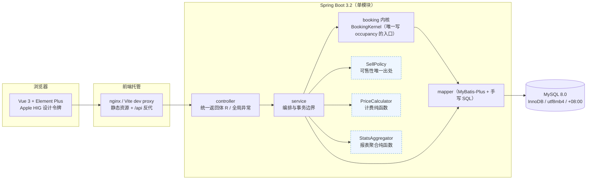
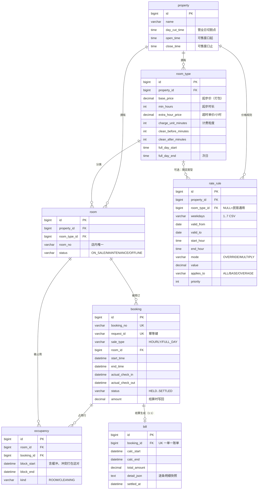
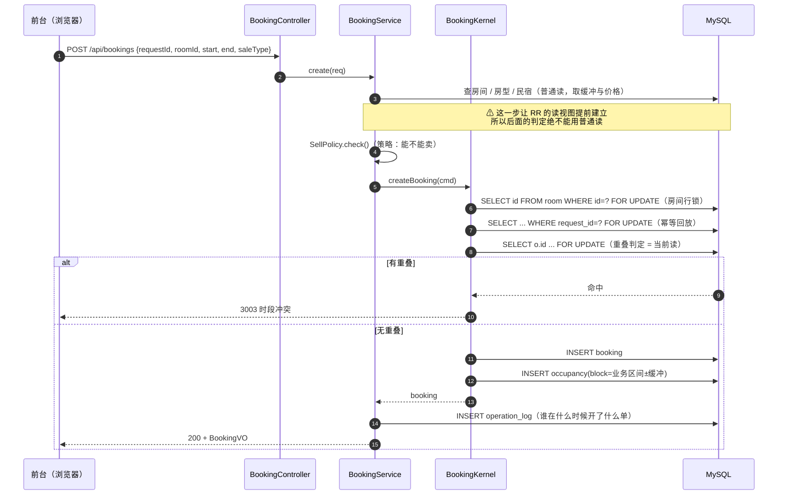
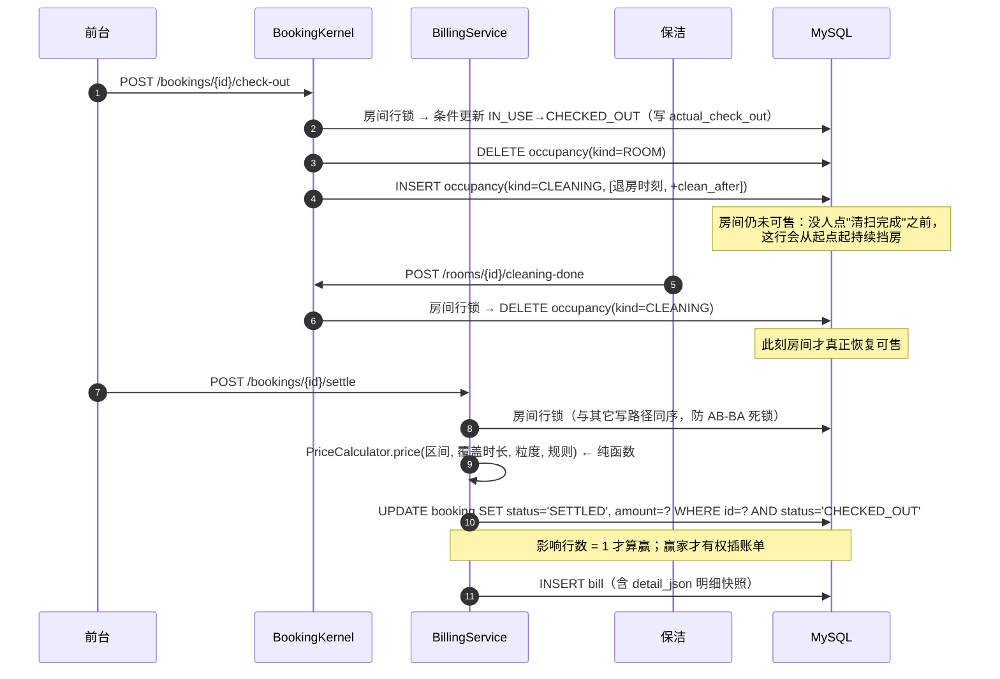

# 论文素材：图与测试用例表

> 图用 Mermaid 写，好处是**能随代码一起改**：改完一跑就知道图对不对，不像截图那样半年后没人敢动。
> 粘进论文前用 draw.io「Arrange → Insert → Advanced → Mermaid」或 Typora 渲染成图即可。
> 最后核对日期：2026-10-29（九轮外部审阅的修复全部落地之后；具体到哪个提交以 `git log -1` 为准，
> 这里不钉死哈希 —— 上一版钉了 `b7275e7`，两次推送之后就没人敢再对一遍了）。

---

## 1. 系统架构

三个虚线框是**不碰数据库、不读时钟的纯函数**：可售判断、算钱、报表聚合。
抽出来的理由在论文里可以统一讲：这些逻辑的难点是"边界口径"（缓冲算不算、取整取到哪、
凌晨算哪天），写在 SQL 或 service 里就必须连库造数据才能验证；做成纯函数后，
它们由 52 条表驱动用例覆盖（`PriceCalculatorTest` 34 + `StatsAggregatorTest` 18），
毫秒级跑完，改口径时立刻知道坏了什么。

## 2. E-R 图

图上要讲的三个设计点：

1. **`occupancy` 是唯一参与冲突检测的表**，`booking` 只是业务档案。所以历史订单在 `occupancy`
   里查不到 —— 退房即删行。由此推出一条铁律：**报表一律读 `booking`/`bill`，不读 `occupancy`**。
2. **`occupancy` 只有一对 `block_*` 参与判定**，业务时间 `start/end` 与它分开存。
   缓冲、提前入住、清扫窗口都只动 `block_*`，业务时间不动 —— 这样"客人看到的时间"和
   "系统挡房的时间"不会互相污染。
3. **`bill.detail_json` 是刻意的反范式**：账单要能回答"当时按什么价算的"，而规则和房型价都会改。
   把逐条明细与命中的规则名一起冻结下来，比加十张关联表便宜，也比只存一个总额诚实。

## 3. 时序图：下单（防超卖的核心路径）

要点：**锁只给互斥，当前读才给可见性**。第 6 步的 `FOR UPDATE` 是整份正确性的承重点 ——
`OversellWithoutLockIT` 把它换回普通 SELECT 之后，100 个并发请求全部成功（正常应为 10）。

## 4. 时序图：退房 → 清扫 → 结算

这条链上每个箭头都有对应测试，报告里最值得放的一句是：
**"可售"这个信号是保洁点出来的，不是时间到了自动变的** —— 这正是需求方要的闭环。

## 5. 测试用例表（精选，按论文论点组织）

> 全量后端 186 条用 `mvn -B test` 跑，前端 9 条用 `cd frontend && npm test`（vitest）单独跑——
> `mvn test` 不会带上前端。这里挑的是能直接支撑论点的。
> "编号"可直接用作论文附录表格的行号。

### 5.1 并发正确性（论文第 4 章）

| 编号 | 场景 | 预期 | 实测 | 用例 |
|---|---|---|---|---|
| C-01 | 50 线程抢同一间房同一时段，10 轮 | 每轮仅 1 单成功，其余 3003 | 通过 | `ConcurrencyBenchIT` |
| C-02 | 同上，连接池 50 | 结论不变（串行点是行锁不是连接数） | 通过 | `ConcurrencyBenchPool50IT` |
| C-03 | **反向对照**：保留行锁、判定换普通 SELECT、RR | 出现超卖 | 100/100 成功、10/10 轮超卖 | `OversellWithoutLockIT` |
| C-04 | 连接池强行改回 RR，真实入口 12 轮并发 | 仍不超卖（修复不依赖 RC 配置） | 通过 | `OversellUnderRepeatableReadIT` |
| C-05 | 只锁房间、判定用普通 SELECT（RR） | 读到旧快照 → 两行落地 | 通过（机制验证） | `OversellAuditIT` |
| C-06 | 同一 `requestId` 重复提交 | 返回原单，不产生第二行占用 | 通过 | `OversellAuditIT` |
| C-07 | 同一 `requestId` 带不同时段 | 拒绝（3005），不回放旧单 | 通过 | `OccupancyTruthIT` |
| C-08 | 第一次成功后房间被下架 / 房型最短时长被调大，再按同 `requestId` 重试 | **返回原单**且不多占一行；同期新单照样被挡（闸门没被一起拆） | 通过 | `OccupancyTruthIT` |
| C-09 | 同 `requestId` **改了时段**重试，且新时段此刻不可售 | 仍是 `3005`（不被 `2003` 抢掉）—— "这个请求已经开出去过一张单"才是前台需要的那句话 | 通过（撤掉修复实测拿到 2003） | `OccupancyTruthIT` |

### 5.2 占用真实性（论文 4.4）

| 编号 | 场景 | 预期 | 用例 |
|---|---|---|---|
| O-01 | 客人超时未退房，计划离店之后的新单 | 拒绝（3003） | `OccupancyTruthIT` |
| O-02 | 提前入住：客人 10:00 到、计划 14:00 | 前段也占住，别人开不走 | `OccupancyTruthIT` |
| O-03 | 提前入住会与他人已订时段重叠 | 拒绝，且占用起点不变、状态回滚 | `OccupancyTruthIT` |
| O-04 | 提前入住后加时 | 起点仍是实际入住时刻，不被抹回计划时间 | `OccupancyTruthIT` |
| O-05 | 退房后未点"清扫完成"，预计时长已过 | 仍不可售；点了之后可售 | `OccupancyTruthIT` |
| O-06 | 超时在住 / 未确认清扫的行整段落在窗口之左 | 仍出现在当天日历（否则没有处理入口） | `CalendarIT` |
| O-07 | 边界相接 `[10,12)` 与 `[12,14)` | 不冲突（半开区间） | `BookingKernelIT` |
| O-08 | 相接但被 45 分钟清扫缓冲挡住 | 冲突 | `BookingKernelIT` |
| O-09 | 改期到冲突时段 | 拒绝且旧占用回滚 | `BookingFlowIT` |
| O-10 | 晚退房把 30 分钟清扫窗口挤到下一单起点 | 窗口截断且不造重叠行；**操作日志写实际分钟数**（配置 30、实际 10 就写 10） | `OccupancyTruthIT`、`CheckOutLogNoteTest` |
| O-11 | **按时**入住，但上一位客人超时未退房 | 拒绝（开单闸门拦不住"已存在订单去兑付"） | `OccupancyTruthIT` |
| O-12 | 按时入住，但房间还在等清扫 | 拒绝；点完「清扫完成」后可入住 | `OccupancyTruthIT` |
| O-13 | 办入住期间房间被改成维修 | 拒绝（2003） | `OccupancyTruthIT` |
| O-14 | 客人 14:00 才到、单子 10:00–12:00 已结束 | 拒绝办入住，引导改期/重开单（否则会与 13:00 那单同住） | `OccupancyTruthIT` |
| O-15 | 恰好卡在结束时刻办入住 | 拒绝（半开区间，`at >= end` 即过期） | `OccupancyTruthIT` |
| O-16 | 加锁后再 `selectById` 查房间 | 命中 MyBatis 一级缓存返回**旧**状态；锁查询才返回最新行 | `OccupancyTruthIT` |
| O-17 | 晚退房 15 分钟、下一单 12:30 开 | 清扫窗口截断到 12:30，不产生重叠行 | `OccupancyTruthIT` |
| O-18 | 下一单已经开始才退房 | 清扫窗口被挤没：不插行、不假设可售 | `OccupancyTruthIT` |
| O-19 | 下单时房间已被改成维修 | 锁内复核拒绝（开单不再只看锁外的快照） | `OccupancyTruthIT` |
| O-20 | 提前三天办入住 | 拒绝（提前入住上限 24 小时；提前一小时照常放行） | `OccupancyTruthIT` |
| O-21 | 房里还有未完成订单时下架 | 拒绝，要求先取消/改期 | `RoomCatalogIT` |

### 5.3 计费口径（论文第 5 章）

| 编号 | 场景 | 预期 | 用例 |
|---|---|---|---|
| P-01 | 超时 61 分钟、粒度 60 | 按 **2 小时**收（不足一小时按一小时，61 分钟跨两个计费单元） | `PriceCalculatorTest` |
| P-02 | 同一张单粒度 60 / 30 / 1 | 三种金额，粒度是配置项 | `PriceCalculatorTest` |
| P-03 | 规则同时命中多条 | priority → 房型级 → id 全序决胜 | `PriceCalculatorTest` |
| P-04 | 假日一口价 488 + 延迟退房 1 小时 | 只改房费 → 528；ALL → 976（对照） | `PriceCalculatorTest` |
| P-05 | 早退 / 晚走 | 早退不退差价；晚走按实际退房时刻补收 | `BillingIT` |
| P-06 | 结算后改房型价 | 历史账单不变，新单用新价 | `BillingIT` |
| P-07 | 重复结算 | 拒绝；账单恒为一行 | `BillingIT` |
| P-08 | 清空规则上的日期/星期/房型限制 | 真的落库，且试算金额随之变化 | `BillingIT` |
| P-09 | 下单后改房型起步时长 | 旧单金额不变（基准已快照），新单按新配置 | `BillingIT` |

### 5.4 营业日切割（论文 5.x）

| 编号 | 场景 | 预期 | 用例 |
|---|---|---|---|
| T-01 | 05:00 的单，切割点 06:00 | 归前一天 | `StatsAggregatorTest` |
| T-02 | 同一时刻，切割点换成 04:00 | 归当天（切割点来自配置） | `StatsAggregatorTest` |
| T-03 | 全日房 14:00→次日 12:00 | 房晚算一天，热力摊两个营业日 | `StatsAggregatorTest` |
| T-04 | 凌晨单的热力格 | 横轴第 20 格、小时标签 2 | `StatsIT` |
| T-05 | 取消/释放单 | 不占房晚、不进营收与热度 | `StatsAggregatorTest` |
| T-06 | 已退房未结算 | 进"待结算"，不进营收 | `StatsAggregatorTest` |
| T-07 | 区间外的单 | 不进任何一天、不进排行 | `StatsAggregatorTest` |
| T-08 | 导出 CSV | UTF-8 BOM + 合计行，Excel 不乱码 | `StatsIT` |
| T-09 | 只查后一天，前一天入住跨进窗口的长单 | 房晚不算，但热力图必须画出那六格 | `StatsAggregatorTest` |
| T-10 | 退房→报表→结算→报表 | 钱从「待结算 1 单」转入「已结算营收」 | `StatsIT` |

### 5.5 状态机与审计

| 编号 | 场景 | 预期 | 用例 |
|---|---|---|---|
| S-01 | HELD→CONFIRMED→IN_USE→CHECKED_OUT→SETTLED | 每步合法 | `BookingFlowIT` |
| S-02 | SETTLED 再结算 / CANCELLED 试算 | 前者 3002，后者 3007 | `BillingIT` |
| S-03 | 确认与超时回收并发 15 轮 | 状态与占用行始终一致 | `BookingFlowIT` |
| S-04 | 一次完整流转 | 开单/入住/退房三条日志都带操作人 | `OperationLogIT` |
| S-05 | 日志的前后值 | 确实是两份快照（不是同一个引用） | `OperationLogIT` |
| S-06 | 房间有历史订单 / 民宿有下级数据 | 拒绝物理删除，引导下架 | `RoomCatalogIT` |
| S-07 | 更新一家不存在的民宿 | 报 `2010`，不能"影响 0 行也返回 200" | `RoomCatalogIT` |
| S-08 | 只带名称保存民宿 | 库里已调过的切割点/营业时间/地址保持不变（以现值为底，只覆盖传来的字段） | `RoomCatalogIT` |

### 5.6 账号与按民宿隔离（论文 6.x 权限设计）

隔离维度只有一列：`sys_user.property_id`。为空 = 店长（全部门店 + 账号管理），非空 = 该民宿前台。
刻意不设 `role` 列 —— 两个字段能组合出"STAFF 但不绑店"这种没人能解释的状态，
角色由这一列派生，界面标签、接口判定、测试断言就只有一个来源。

| 编号 | 场景 | 预期 | 用例 |
|---|---|---|---|
| A-01 | 前台看民宿列表 / 店长看民宿列表 | 1 家 / 全部 | `AuthScopeIT` |
| A-02 | 前台点名请求别家店的房间、日历、报表、可售查询 | 全部 1003，不返回空列表 | `AuthScopeIT` |
| A-03 | 前台不带民宿参数 | 自动收窄，列表每一行都属于自己那家（并有店长侧的对照断言） | `AuthScopeIT` |
| A-04 | 前台给别家店的房间开单 / 给自己店的房间开单 | 前者 1003，后者成功（隔离不能把合法路径一起挡掉） | `AuthScopeIT` |
| A-05 | 操作日志 | 前台只看到本店动作；店长仍看全量 | `AuthScopeIT` |
| A-06 | 前台读写账号接口 | 1003（前端藏入口只是体验，后端不校验才是漏洞） | `AuthScopeIT` |
| A-07 | 店长停用某人后，那人正在用的 session | 下一个请求即 401（每请求回读账号） | `AuthScopeIT` |
| A-08 | 编辑账号不传密码 / 传密码 | 旧密码仍可用 / 旧密码立即失效 | `UserAdminIT` |
| A-09 | 停用自己、把最后一个店长改成前台 | 都拒绝（单机部署下这是最难恢复的事故） | `UserAdminIT` |
| A-10 | 账号列表的 JSON | 不含 `password_hash`（哈希进 JSON 就是离线爆破的原料） | `UserAdminIT` |
| A-11 | `GET /api/rooms/{id}`、`/api/bookings/{id}`、`/api/bookings/{id}/bill`（已结算读快照那条分支）指向别店 | 全部 1003 —— 列表过滤做对了不等于按 id 的读也安全 | `AuthScopeIT` |
| A-12 | `PUT /api/{rooms\|room-types\|rate-rules}/{别店 id}`，请求体填本店 `propertyId` | 1003，且回查库里 `property_id` 没被搬走（只认新归属、不认原归属是这一类的通病） | `AuthScopeIT` |
| A-13 | 清空某前台账号的归属以升为店长 | 库里 `property_id` 必须真的写成 NULL（MyBatis-Plus 默认跳过 null 字段 → 接口 200、VO 也显示"店长"，只有下次登录才发现没升上去） | `UserAdminIT` |
| A-14 | 两个店长并发互相降级 | 只能成一个，店长数不能归零（check-then-act 要靠 `SELECT ... FOR UPDATE` 串行化） | `UserAdminIT` |

---

## 6. 还差什么（需要你本人动手的部分）

- **架构图/E-R/时序图渲染成 PNG**：把上面四段粘进 draw.io 或 Typora，导出图片插进论文。
- **演示截图**：登录页、房态日历（含待清扫块与超时斜纹）、账单弹窗、报表页三张图
  （报表页的「旋转 / 不旋转」对照图尤其值得放）。
- **论文正文**：`README.md` 的「预订内核的四条规则」「计费」「报表」「压测与反向对照」四节
  基本就是第 4、5 章的骨架，可逐段改写。
